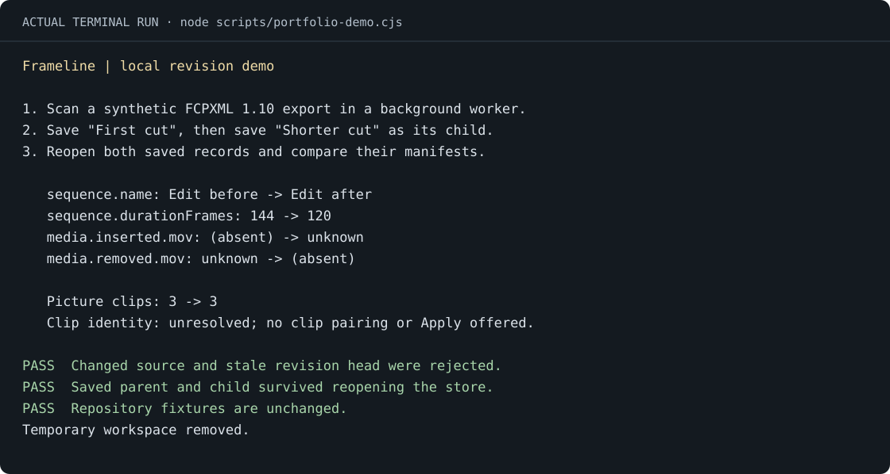

# Try Frameline in a few minutes

The quickest demo runs from the terminal. It uses the app's real background scanner, local revision store, and comparison code with two small, synthetic timeline exports. You don't need Resolve, media files, an account, or a server.

From the repository root, after [setup](SETUP.md):

```sh
npm run demo
```



This is a rendering of an actual terminal run, rather than an app screenshot. The same output is available as [plain text](docs/demo/transcript.txt).

## What happens

The demo creates a fresh temporary folder and copies two [public fixtures](phase-0/compatibility-corpus/) into it. It scans the first export, saves **First cut**, then replaces only the temporary export and saves **Shorter cut** as a child revision. A new store instance reopens both records and compares their verified manifests.

The sequence shrinks from 144 to 120 frames at 24 fps. The media inventory gains `inserted.mov` and loses `removed.mov`. Those media names are supplied by the fixtures; their availability is `unknown` because the fixtures contain no file locations or media payloads.

Two rejection checks run along the way: the old source hash cannot verify the changed export, and an outdated branch head cannot save another revision. The demo also checks that both repository fixtures keep their original bytes. It exits with a failure status if any check fails, then removes its temporary folder.

Clip counts remain three in each version. The comparison makes no claim that it has matched individual clips across exports. It does not merge, change an editor project, or run native Apply.

For structured output or a retained workspace:

```sh
npm run demo -- --json
npm run demo -- --keep
```

`--keep` prints the new temporary folder's path. It contains `timeline.fcpxml`, both source fixtures, and a `history` folder with the two real saved revisions. Each run creates a separate folder; it never opens your normal Frameline workspace. Remove retained demo folders yourself when you're done.

## Walk through the desktop app

This takes the same before-and-after example through the interface. Desktop history is separate from the terminal demo's private history folder.

1. Run `npm run demo -- --keep`. Copy the printed folder path.
2. Set `DEMO_DIR` below to that path, then prepare the first export:

   ```sh
   DEMO_DIR="/replace/with/the/printed/frameline-portfolio-folder"
   cp "$DEMO_DIR/edit-before.fcpxml" "$DEMO_DIR/timeline.fcpxml"
   npm start
   ```

3. On first launch, use **Choose folder** to select a new disposable folder for revision history, then finish workspace setup. Select the experimental Resolve integration if asked. Resolve itself is unnecessary for this read-only fixture scan.
4. Use **Choose file** to open the temporary `timeline.fcpxml`. Inspect the picture clips and media inventory. Unresolved media is expected.
5. Open **History** and save a revision with the message **First cut**.
6. In a second terminal, set `DEMO_DIR` to the same path and replace the selected temporary export:

   ```sh
   DEMO_DIR="/replace/with/the/same/frameline-portfolio-folder"
   cp "$DEMO_DIR/edit-after.fcpxml" "$DEMO_DIR/timeline.fcpxml"
   ```

7. Click **Rescan project**, then save **Shorter cut** in **History**. Open its revision details to inspect the sequence and media changes against its parent.

Keep the same `timeline.fcpxml` path for both scans: selecting the two different fixture paths would create separate local project identities. The sample workspace shown before file selection is illustrative; selecting the fixture replaces it with scanned data.

## Where the harder integration work lives

The terminal demo covers the portable read-only path. The [native Apply guide](SAFE_APPLY.md), [native checkpoint guide](NATIVE_CHECKPOINT_REVIEW.md), and [compatibility notes](PERSONAL_COMPATIBILITY.md) describe the separately tested Resolve work and its exact limits. Native Apply is limited to one existing video clip's Name on the recorded Resolve build; the fixture demo does not establish broader editor support.

The checked-in terminal view can be refreshed from a successful run of `node scripts/portfolio-demo.cjs`. Its text is deliberately free of local paths and machine-specific revision IDs.
