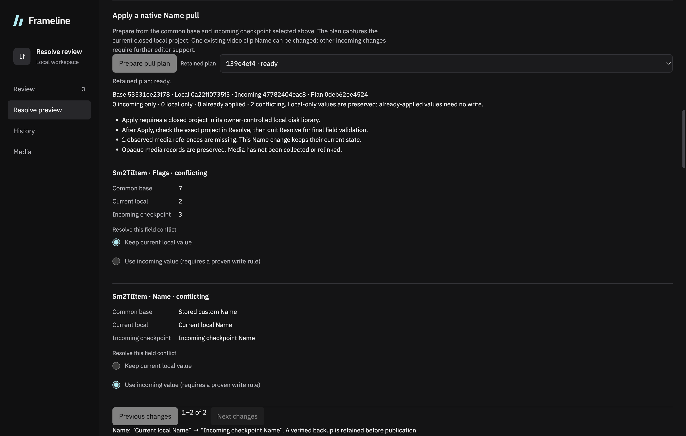

# Frameline

**Version history and change review for video editing projects.**

Video editors often pass around whole project files to share a small edit. Frameline explores a more useful workflow: save a revision, compare it with another version, review conflicts, and preserve a way back before changing anything.

This is a résumé portfolio project built with Electron, JavaScript, Node.js, and a focused DaVinci Resolve integration. It includes a working local revision system, three-way comparison, crash recovery, and an optional self-hosted collaboration service. The native write path is deliberately narrow: one reviewed video clip name on the tested Resolve build.

## Try it without an editor

Use Node.js 24 and npm, then run these commands from the repository root:

```sh
npm ci
npm run demo
```

The demo runs the real scanner, revision store, and comparison code against synthetic fixtures in a temporary workspace. It needs no Resolve installation, account, cloud service, or personal media. See [the demo walkthrough](DEMO.md) for the output and a desktop tour, or [setup instructions](SETUP.md) to open the app.

## What it does

- **Keeps local history.** Scan FCPXML exports, save immutable revisions, create branches, and export or restore revision backups.
- **Makes changes reviewable.** Compare sequence metadata and media inventories; use three-way review for captured Resolve fields and authenticated native checkpoints.
- **Treats edits as recoverable transactions.** Bind review to exact source bytes, verify a backup, check the result in Resolve, and retain recovery state across restarts.
- **Separates media from history.** Audit original and proxy references locally. The optional HTTPS service adds explicit, resumable media transfers with content verification and project permissions.



*Desktop integration check using synthetic checkpoint data. The review keeps an unsupported Flags change local and selects an incoming Name change. This screenshot shows the interface; live Resolve validation has separate [evidence and limits](NATIVE_PULL.md#verification).*

## The engineering behind it

The hardest part was deciding what a safe edit actually requires. An export can omit fields, an editor can change unrelated data on save, and a clip's position is a poor substitute for identity. Frameline keeps these concerns explicit rather than treating a successful file write as proof.

| Problem | Approach | Start reading |
| --- | --- | --- |
| A review goes stale before Apply | Hash-bound plans and fresh source checks before execution | [Pull planning](src/native-pull-plan.js) |
| An edit changes unrelated project data | Complete stored-field comparisons and a single supported write rule | [Preservation research](phase-0/RESOLVE_NATIVE_PRESERVATION.md) |
| A crash leaves the result uncertain | Durable transaction journals, verified backups, and explicit recovery | [Apply transaction](src/closed-project-apply-transaction.js), [recovery](CRASH_RECOVERY.md) |
| Two writers advance the same branch | Compare-and-swap updates and idempotent requests | [Service design](SERVICE_FOUNDATION.md) |
| Scanning blocks the interface | Cancellable worker scans, exact frame arithmetic, and windowed lists | [Scanner](src/fcpxml-scan-controller.js), [large projects](LARGE_PROJECTS.md) |

The desktop renderer talks to a narrow preload API. File access, credentials, validation, and persistence stay in the main process. Scans run in a worker; optional collaboration goes through an authenticated HTTPS service. [System design](SYSTEM_DESIGN.md) covers the wider architecture and its original goals.

## Tested boundaries

FCPXML **1.10** scanning covers the first sequence's top-level picture clips and referenced media inventory. Nested content and unsupported constructs produce warnings. Scanned FCPXML revisions do not support clip-level merge or Apply.

Native editor checks target **DaVinci Resolve Free 21.1.2, build 21.1.20010, on macOS**. The proven Apply operation changes one existing video clip's Name in a verified, closed local project, with editor readback and restoration. It does not establish general timeline editing, lossless SDK Save, other editor versions, or cross-device identity. See [exact compatibility](PERSONAL_COMPATIBILITY.md) and [Safe Apply](SAFE_APPLY.md).

The service runs locally or on a self-managed host; no public cloud deployment or signed installer is provided. Public launch work, more editors, real-time co-editing, and cloud rendering are outside the [portfolio scope](PROJECT_SCOPE.md).

## Run the checks

```sh
npm run test:demo
npm run test:fixtures
npm test
```

Tests cover comparison, immutable history, access control, transfers, migrations, corruption, and recovery. Some owner-retained native evidence checks skip when their private fixtures are absent; a public checkout does not repeat a live Resolve validation. [Setup](SETUP.md) explains platform requirements and the different verification paths. [CI](.github/workflows/ci.yml) defines the automated checks; [the roadmap](ROADMAP.md) records completed work and optional future ideas.
